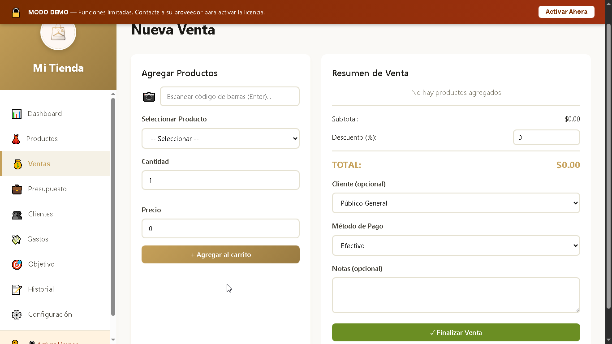
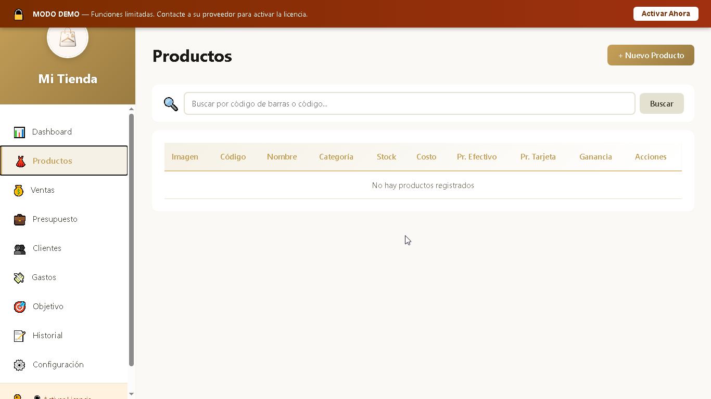
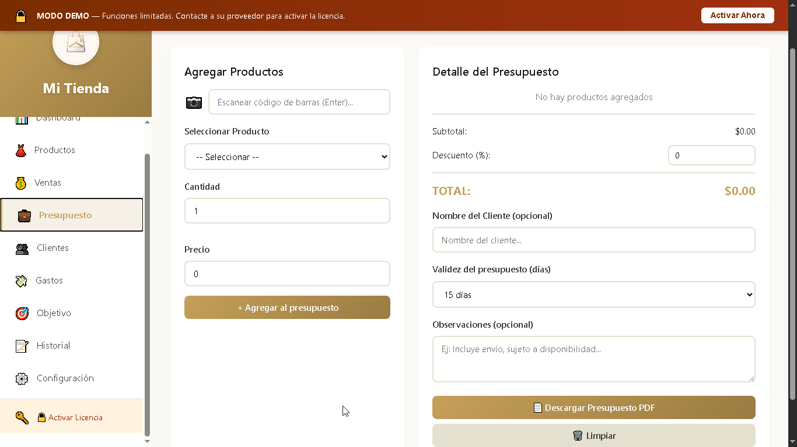
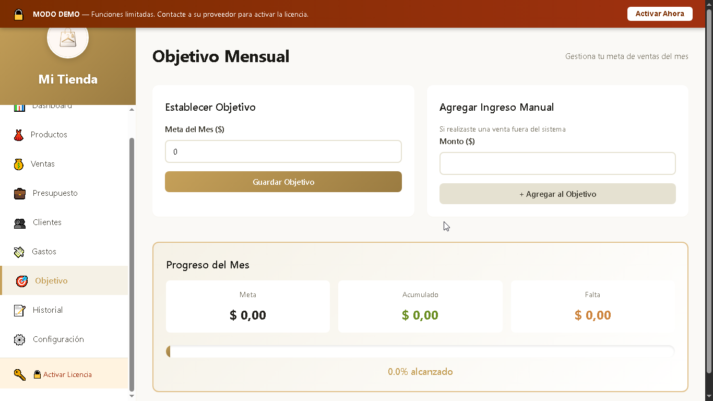
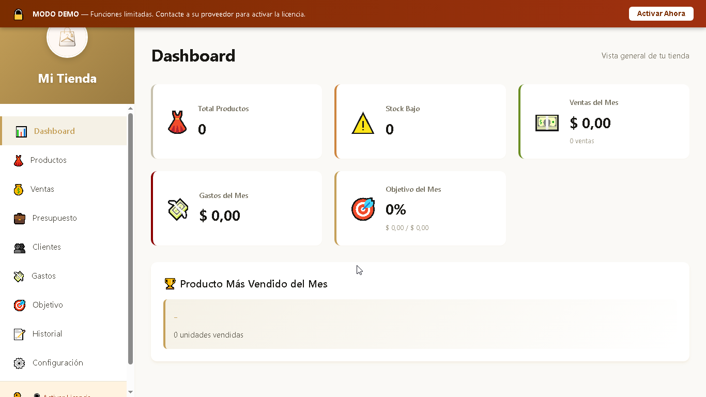

<div align="center">

  

  # 🛍️ InventApp Web
  
  ### **Plataforma Web Oficial & Showcase Interactivo de Gestión Comercial**

  <p align="center">
    <a href="https://lurdciano.github.io/InventAppWeb/"></a>
    <a href="./LICENSE"></a>
    <a href="https://www.linkedin.com/in/luciano-ruizdiaz"></a>
    <a href="https://github.com/Lurdciano"></a>
  </p>

  <p align="center">
    
    
    
    
  </p>

  <br/>

  ### 🌐 [Explorar Demo en Vivo (GitHub Pages)](https://lurdciano.github.io/InventAppWeb/)

</div>

---

## 📖 Índice

- [📌 Acerca del Proyecto](#-acerca-del-proyecto)
- [✨ Módulos y Funcionalidades del Sistema](#-módulos-y-funcionalidades-del-sistema)
- [📸 Capturas de Pantalla Reales](#-capturas-de-pantalla-reales)
- [🛠️ Stack Tecnológico](#️-stack-tecnológico)
- [🔒 Seguridad & Políticas Web](#-seguridad--políticas-web)
- [📂 Estructura del Repositorio](#-estructura-del-repositorio)
- [⚡ Ejecución Local](#-ejecución-local)
- [📄 Licencia](#-licencia)
- [📬 Contacto](#-contacto)

---

## 📌 Acerca del Proyecto

**InventApp Web** es el sitio web oficial y centro de exhibición interactivo diseñado para presentar **InventApp**, una solución de software integral orientada al control de stock, punto de venta (POS), presupuestos cotizados y seguimiento de metas para comercios minoristas, tiendas de indumentaria y calzado.

La landing page fue desarrollada con estándares modernos de diseño web UI/UX:
* **Dark Mode & Glassmorphism:** Paleta profunda (`#0a0f1a` a `#1a2332`) con efectos de desenfoque translúcido y bordes sutiles.
* **Experiencia Interactiva:** Modal de pantalla completa (lightbox) para previsualizar capturas en alta definición y reproducir demostraciones en video.
* **Microinteracciones Fluidas:** Navegación suave (*smooth scroll*), acordeones colapsables para información ampliada, animaciones al hacer scroll (*Intersection Observer*) y copiado con un clic para contacto directo.
* **Arquitectura Liviana:** 100% Vanilla (HTML5, CSS3 y JavaScript nativo), sin dependencias externas pesadas, asegurando una carga ultrarrápida.

---

## ✨ Módulos y Funcionalidades del Sistema

| Módulo | Descripción Funcional |
| :--- | :--- |
| **💰 Punto de Venta (POS)** | Facturación ágil mediante buscador rápido de productos por nombre o código, confirmaciones de seguridad antes del cobro y soporte para pagos en **Efectivo**, **Transferencia**, **Tarjeta** y **Cuentas Corrientes**. |
| **👗 Control de Inventario** | Monitoreo de stock en tiempo real, validación automática previa a cada venta para evitar quiebres de existencias, categorización de productos y alertas automáticas de reposición. |
| **📄 Generador de Presupuestos** | Creación y emisión de cotizaciones formales sin alterar el inventario real ni registrar ventas definitivas, con exportación directa en formato **PDF profesional** listo para enviar por WhatsApp o correo. |
| **🎯 Objetivos & Metas Comerciales** | Configuración de metas mensuales de facturación, seguimiento automatizado del progreso diario y registro de ingresos extraordinarios con gráficos e indicadores visuales de rendimiento. |

---

## 📸 Capturas de Pantalla Reales

<div align="center">

### 💰 Punto de Venta (POS) & Caja
> Interfaz ágil para la facturación con desglose de métodos de pago y confirmación de seguridad.
<br/>


<br/><br/>

### 👗 Gestión de Inventario y Stock
> Control centralizado de existencias, precios, categorías y avisos de reposición.
<br/>


<br/><br/>

### 📄 Generador de Presupuestos en PDF
> Confección ágil de cotizaciones personalizadas con validez temporal y notas adicionales.
<br/>


<br/><br/>

### 🎯 Objetivo Mensual & Estadísticas
> Panel visual de seguimiento de metas de facturación y control financiero.
<br/>


<br/><br/>

### 🎬 Demostración en Video del Sistema
> Visualización interactiva y dinámica de la operatoria del software.
<br/>


</div>

---

## 🛠️ Stack Tecnológico

* **Frontend:** HTML5 Semántico, CSS3 Moderno (Custom Properties, Flexbox, CSS Grid, Glassmorphism).
* **Lógica & Comportamiento:** JavaScript Nativo (Vanilla JS ES6+).
* **Seguridad Web:** Configuración estricta de Content Security Policy (CSP), cabeceras de prevención XSS, `nosniff`, `frame-ancestors / DENY` y Referrer-Policy.
* **SEO & Divulgación:** Directivas en `robots.txt`, `security.txt` estándar y metadatos adaptables a indexación de motores de búsqueda.
* **Hosting:** GitHub Pages con entrega optimizada bajo HTTPS.

---

## 🔒 Seguridad & Políticas Web

El sitio web incorpora directivas de seguridad para garantizar una navegación protegida y transparente:

* **Cabeceras de Seguridad:**
  ```html
  <meta http-equiv="X-Content-Type-Options" content="nosniff">
  <meta http-equiv="X-Frame-Options" content="DENY">
  <meta http-equiv="X-XSS-Protection" content="1; mode=block">
  <meta http-equiv="Referrer-Policy" content="strict-origin-when-cross-origin">
  <meta http-equiv="Content-Security-Policy" content="default-src 'self'; script-src 'self' 'unsafe-inline'; style-src 'self' 'unsafe-inline'; img-src 'self' data:; media-src 'self'; connect-src 'self'; font-src 'self';">
  ```
* **Divulgación de Seguridad (`security.txt`):** Contacto directo para reporte de vulnerabilidades y clave PGP.
* **Control de Rastreo (`robots.txt`):** Optimización para rastreadores autorizados y bloqueo de rutas sensibles.

---

## 📂 Estructura del Repositorio

```bash
InventAppWeb/
├── images/
│   ├── Caja.png              # Captura del módulo de punto de venta (POS)
│   ├── Demo.mp4              # Archivo de video con demostración del sistema
│   ├── Demo.png              # Portada/miniatura del video demostrativo
│   ├── Inventario.png        # Captura de la administración de stock y productos
│   ├── LogoTienda.png        # Isotipo / logotipo oficial de InventApp
│   ├── Objetivo.png          # Captura del panel de metas y objetivos mensuales
│   └── Presupuesto.png       # Captura del módulo de cotización y presupuestos PDF
├── .gitignore                # Reglas de exclusión para archivos temporales y sensibles
├── index.html                # Página principal (Single Page Application responsive)
├── LICENSE                   # Licencia de código abierto MIT
├── README.md                 # Documentación completa del proyecto
├── README.txt                # Notas y guía técnica de activación complementaria
├── robots.txt                # Directivas para motores de búsqueda (SEO)
└── security.txt              # Declaración de políticas de seguridad y contacto
```

---

## ⚡ Ejecución Local

Para visualizar y probar el proyecto en tu entorno local:

1. **Clonar el repositorio:**
   ```bash
   git clone https://github.com/Lurdciano/InventAppWeb.git
   cd InventAppWeb
   ```

2. **Abrir en tu navegador:**
   * Simplemente haz doble clic en `index.html`, o
   * Usa cualquier servidor local estático (por ejemplo con la extensión **Live Server** en VS Code o vía Python):
     ```bash
     # Con Python 3
     python -m http.server 8000
     ```
     Y navega en tu explorador a `http://localhost:8000`.

---

## 📄 Licencia

Este proyecto se encuentra bajo los términos de la licencia **MIT**. Para más detalles, consulta el archivo [LICENSE](./LICENSE).

---

## 📬 Contacto

**Luciano Ruiz Diaz** — *Analista Funcional & Diseñador de Soluciones de Software*

* 💼 **LinkedIn:** [linkedin.com/in/luciano-ruizdiaz](https://www.linkedin.com/in/luciano-ruizdiaz)
* 🐙 **GitHub:** [github.com/Lurdciano](https://github.com/Lurdciano)
* 📧 **Email:** [lurdciano@gmail.com](mailto:lurdciano@gmail.com)
* 🌐 **Organización:** [TerraCode](https://terracode.site/)

<div align="center">
  <sub>Desarrollado con dedicación por <b>Luciano Ruiz Diaz</b> · © 2026</sub>
</div>
